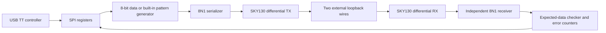

# SKY26e differential byte transceiver

This directory contains a locally checked SKY130 2×2 layout candidate (four tiles), retaining the full transceiver and 32-bit self-test counters. The development repository root remains preserved GF180 material; use the SKY-specific standalone repository for submission preparation. The candidate passes 17 prechecks, full exported-GDS transistor LVS, 44 routed digital tests, 30 extracted analog loopback cases and nine timing corners. See [the compact layout package](layout_compact/README.md); shuttle integration and board validation remain.

The PHY is a custom short-link electrical interface. It is not qualified as LVDS, RS-485 or another standard interface. The starting target is 100 kbit/s at 1.8 V supply, with approximately half-supply common mode and a selectable stronger TX drive. Do not apply a standard differential termination or assume cable-length, noise or ESD performance from the simulations.

For self-test, connect ua[0] TX+ to ua[2] RX+, and ua[1] TX- to ua[3] RX-. One TX and one RX on the same design suffice. The USB controller supplies the clock, configures tests and reads results; an oscilloscope is not required for functional pass/fail readout. Two separately clocked chips can later use two pairs for full duplex, subject to electrical/interoperability qualification.

- [Architecture and acceptance gates](ARCHITECTURE.md)
- [Register protocol and pin map](REGISTERS.md)
- [Host driver and physical test instructions](host/README.md)
- [Verification status and limitations](verification/STATUS.md)

Reproduce digital checks with `python3 sky26e/scripts/test_rtl.py` and `python3 sky26e/scripts/test_mapped.py`. Run the schematic matrix with `python3 sky26e/scripts/test_analog.py`. The scripts default to the isolated pinned PDK alongside this checkout; mapped/SPICE runners also accept PDK_ROOT pointing directly to sky130A. Tool staging instructions are in tools/README.md. Generated waves and placement runs are ignored; checkpoint summaries and source hashes are tracked.
